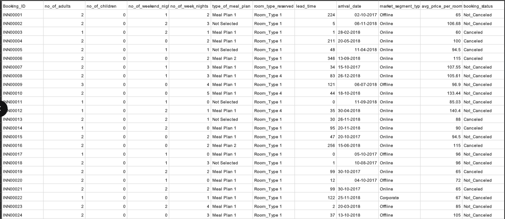
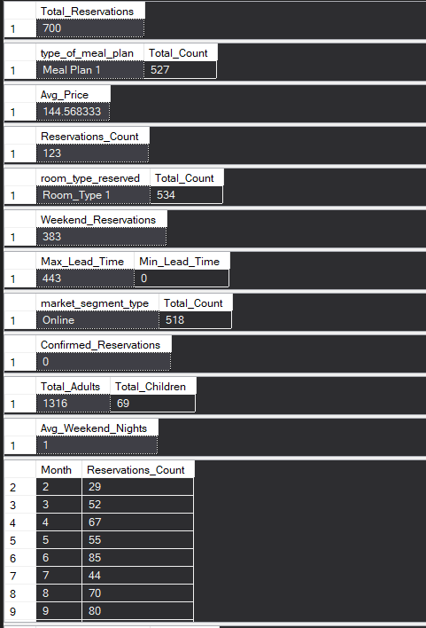
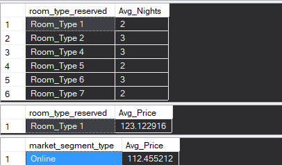
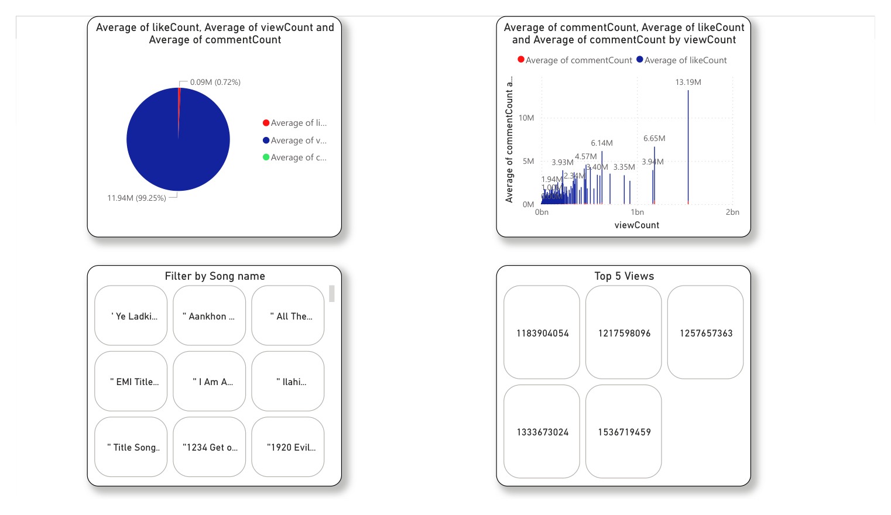
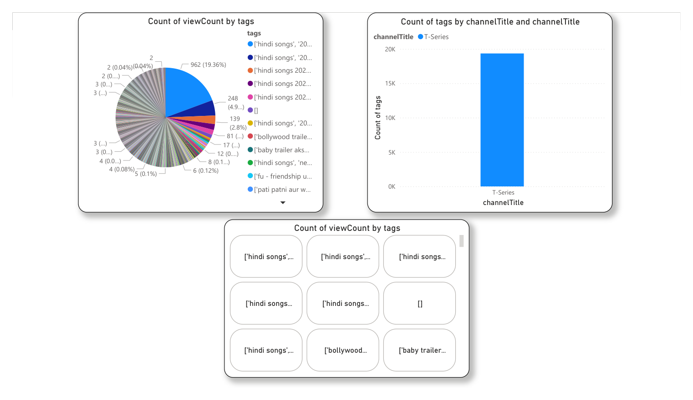
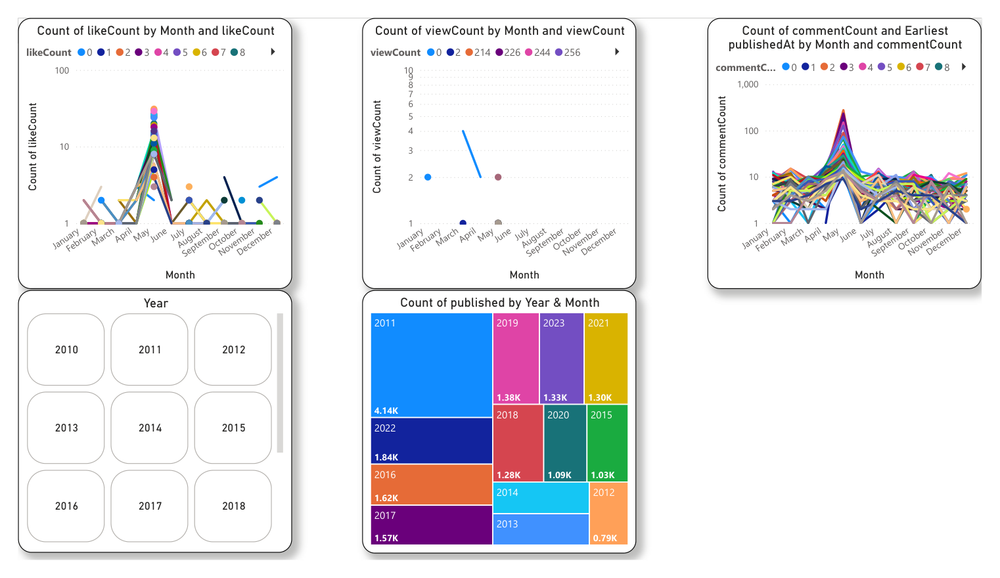
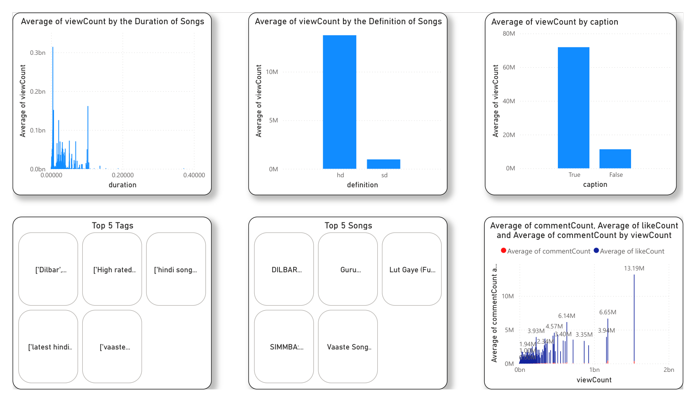

# Mentorness Data Analysis Internship

Two data-analysis tasks from a remote internship with **Mentorness** (India): a hotel booking analysis in SQL and a YouTube song performance dashboard in Power BI.

| Task | Tools | Files |
|---|---|---|
| [1. Hotel reservation analysis](#1-hotel-reservation-analysis-sql) | SQL Server (T-SQL), Python (pandas) | [`Hotel reservation Data analysis using SQL/`](Hotel%20reservation%20Data%20analysis%20using%20SQL) |
| [2. YouTube song video performance](#2-youtube-song-video-performance-power-bi) | Power BI | [`YouTube Song Video Performance Analysis/`](YouTube%20Song%20Video%20Performance%20Analysis) |

---

## 1. Hotel reservation analysis (SQL)

The table has 700 hotel bookings (`INN00001` to `INN00700`, arrivals in 2017–2018) with 12 columns: guests, weekend and week nights, meal plan, room type, lead time, arrival date, market segment, average room price and booking status.



**Workflow:** create the `HotelReservations` table, then use a small Python script to turn the CSV into 700 `INSERT` statements. The CSV's dates are `DD-MM-YYYY` and the script rewrites them as `MM-DD-YYYY` so SQL Server can parse them. Finally, answer 15 business questions with T-SQL.

### Business questions

1. What is the total number of reservations?
2. Which meal plan is the most popular?
3. What is the average price per room for reservations with children?
4. How many reservations were made for 2017?
5. What is the most commonly booked room type?
6. How many reservations include a weekend night?
7. What are the highest and lowest lead times?
8. What is the most common market segment?
9. How many reservations have the status "Confirmed"?
10. How many adults and children are there across all reservations?
11. What is the average number of weekend nights for reservations with children?
12. How many reservations are there in each month?
13. What is the average stay (weekend + week nights) per room type?
14. For reservations with children, what is the most common room type and its average price?
15. Which market segment has the highest average price per room?

### Selected queries

The queries are copied from [`Hotel reservation dataset.sql`](Hotel%20reservation%20Data%20analysis%20using%20SQL/Hotel%20reservation%20dataset.sql).

```sql
-- Most popular meal plan
SELECT TOP 1 type_of_meal_plan, COUNT(*) AS Total_Count
FROM HotelReservations
GROUP BY type_of_meal_plan
ORDER BY Total_Count DESC;

-- Average room price for reservations involving children
SELECT AVG(avg_price_per_room) AS Avg_Price
FROM HotelReservations
WHERE no_of_children > 0;

-- Reservations per month
SELECT MONTH(arrival_date) AS Month, COUNT(*) AS Reservations_Count
FROM HotelReservations
GROUP BY MONTH(arrival_date);

-- Average length of stay per room type
SELECT room_type_reserved, AVG(no_of_weekend_nights + no_of_week_nights) AS Avg_Nights
FROM HotelReservations
GROUP BY room_type_reserved;

-- Most common room type for families, and its average price
SELECT TOP 1 room_type_reserved, AVG(avg_price_per_room) AS Avg_Price
FROM HotelReservations
WHERE no_of_children > 0
GROUP BY room_type_reserved
ORDER BY COUNT(*) DESC;

-- Market segment with the highest average price per room
SELECT TOP 1 market_segment_type, AVG(avg_price_per_room) AS Avg_Price
FROM HotelReservations
GROUP BY market_segment_type
ORDER BY Avg_Price DESC;
```

### Key findings

These are the results shown in the presentation (`Hotel Reservation Analysis in SQL.pptx`):

| Question | Result |
|---|---|
| Total reservations | **700** |
| Most popular meal plan | **Meal Plan 1** (527 bookings) |
| Most booked room type | **Room_Type 1** (534 bookings) |
| Most common market segment | **Online** (518 bookings) |
| Highest average price per room, by segment | **Online**, 112.46 |
| Average room price for bookings with children | **144.57** |
| Most common room type for bookings with children | **Room_Type 1**, average price 123.12 |
| Reservations arriving in 2017 | **123** of 700 |
| Reservations with at least one weekend night | **383** |
| Lead time | from **0** to **443** days |
| Guests | **1,316 adults** and **69 children** |
| "Confirmed" reservations | **0**, see the note below |

 

**Notes on the results:**

- The "Confirmed" query returns 0 because the data has no `Confirmed` status, only `Canceled` and `Not_Canceled`. The intended question is answered by `WHERE booking_status = 'Not_Canceled'`.
- `AVG()` over `INT` columns in SQL Server returns an integer. As a result, *average weekend nights* (1) and *average nights per room type* (2 or 3) are truncated. Writing `AVG(CAST(... AS DECIMAL(5,2)))` gives the exact averages.

---

## 2. YouTube song video performance (Power BI)

This task is a Power BI report on YouTube song video statistics (views, likes, comments, tags, channel, publish date, duration, definition and captions), with a slide deck of findings and recommendations. The repository has the report template (`Youtube song analysis.pbit`, which contains no data), the exported report (`task3.pdf`) and the deck (`Reports and recommnedations.pptx`). The source dataset is not included.

### Business questions

- Which channels and tags appear most, and which tags have the most views?
- How do views, likes and comments relate?
- When are songs published, and in which months do views peak?
- Do duration, HD vs SD, and captions affect views?
- Which songs have the most views?

### Dashboard

| | |
|---|---|
|  |  |
|  |  |

### Key findings

These come from the report and the findings deck:

- **Channels and tags:** T-Series dominates the tag count. The most frequent tags are "hindi songs" and "bollywood trailers", and popular tags include "Dilbar" and "High Rated".
- **Top songs by views:** *Dilbar*, *Guru…*, *Lut Gaye*, *Simmba* and *Vaaste*. Each of the top five videos has between 1.18 billion and 1.54 billion views.
- **Engagement:** videos with more views also get more likes and comments. On average, likes are about 0.7% of views.
- **Timing:** views spike in April, June and December. Publishing peaks around 2011, 2016 and 2019, according to the deck.
- **Format:** HD videos get more views on average than SD videos, and captioned videos get far more views on average than uncaptioned ones (about 72M compared with 11M in the report).

### Recommendations (from the deck)

1. Optimise for popular tags and keywords.
2. Publish during high-engagement periods.
3. Improve video quality and accessibility (HD, captions).
4. Engage with the audience.
5. Use analytics for continuous improvement.
6. Collaborate with influential channels.
7. Experiment with content duration and formats.

---

## Tools

- **SQL Server / T-SQL:** table design, aggregation, `GROUP BY`, `TOP`, date functions.
- **Python (pandas):** CSV-to-SQL conversion with date reformatting.
- **Power BI:** report design, slicers, cards, distribution and trend charts.
- **PowerPoint:** presenting the findings.

## How to load the SQL

The script uses SQL Server syntax (`TOP 1`, `MONTH()`, `YEAR()`).

1. In SQL Server Management Studio or Azure Data Studio, create a database, for example `CREATE DATABASE HotelDB; USE HotelDB;`.
2. Open `Hotel reservation Data analysis using SQL/Hotel reservation dataset.sql` and run it. It creates `HotelReservations`, inserts the 700 rows and runs the analysis queries.

   Or from the command line:

   ```bash
   sqlcmd -S localhost -d HotelDB -i "Hotel reservation Data analysis using SQL/Hotel reservation dataset.sql"
   ```

3. To regenerate the inserts from the original CSV:

   ```bash
   pip install pandas
   python "Hotel reservation Data analysis using SQL/csv vonb.py" "path/to/Hotel Reservation Dataset.csv" -o inserts.sql
   ```

   The dates are written as `MM-DD-YYYY`. On a server with a non-US date setting, run `SET DATEFORMAT mdy;` first.

For the dashboard, open `Youtube song analysis.pbit` in Power BI Desktop. It asks for the source data, which is not part of this repository.

## Licence

MIT, see `LICENSE`.
